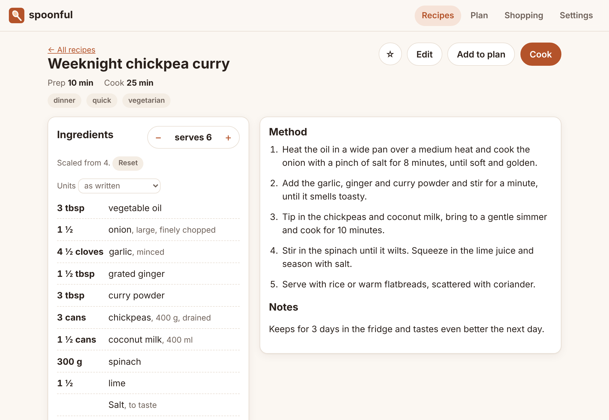
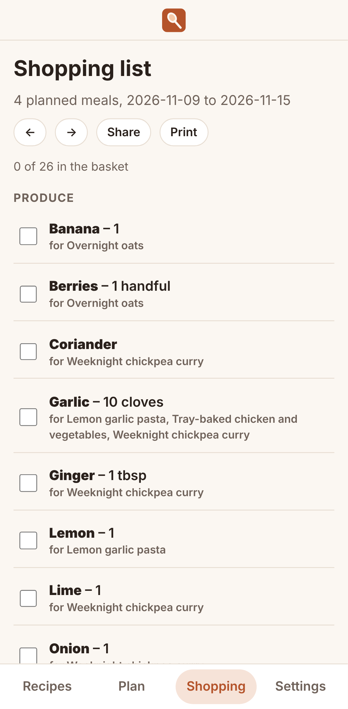
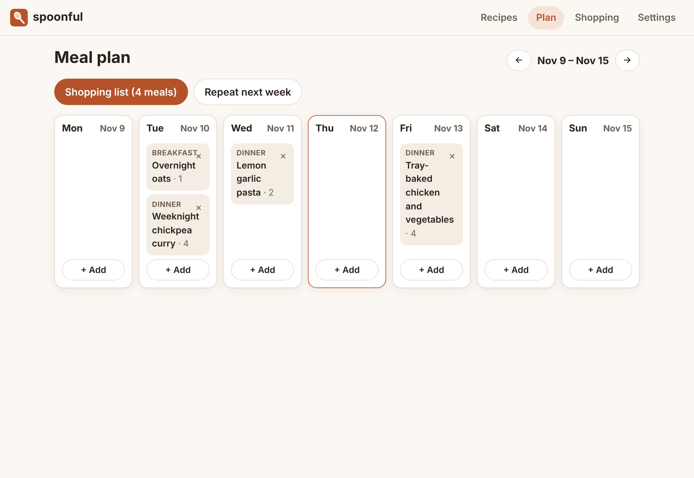
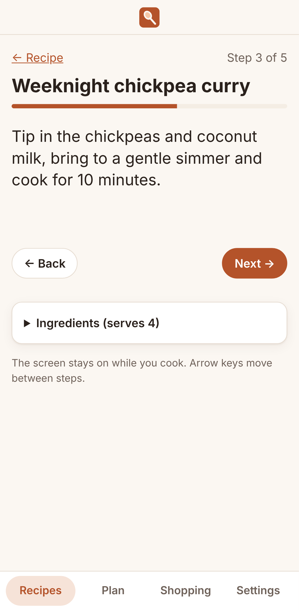

# spoonful

**A recipe box and meal planner that works offline.** Keep your recipes in one place, paste in
ones you find, scale any recipe to the number of people you're feeding, plan the week, and get a
shopping list that adds itself up and follows the aisles of the shop. It runs in any browser,
installs like an app on a phone or computer, and keeps your recipes on your own device.

**Try it: https://zeexduaa.github.io/spoonful/**

<p>
  
  
</p>

## What it does

- **Your recipes, in one place.** Write them yourself, or **paste** one copied from a website,
  an email or a document. spoonful finds the name, servings, times, ingredients and steps, and
  you check everything before it's saved. Many recipe websites include their recipe in the page's
  source code in a standard format. Paste the source and it's read exactly.
- **Scale to any number of servings.** Every amount is recalculated and written the way a cook
  would write it. ¾ cup doubled is **1 ½ cups**, 3 teaspoons become **1 tablespoon**, and
  1250 g becomes **1.25 kg**. You can switch any recipe to cups and ounces, or to grams and
  millilitres.
- **Cook mode.** One big step at a time, with the ingredients at hand, and the screen stays on.
- **Plan the week.** Put recipes on days and meals, drag them around, and repeat a good week.
- **A shopping list that does the adding up.** The same ingredient from different recipes
  becomes one line (2 cups of milk + 250 ml of milk = **3 cups**). Whole things are rounded up
  (you can't buy 1.5 limes). The list is grouped by aisle, says which recipe each item is for,
  and leaves out what you always have (salt, oil…). Tick items off, add your own, then share,
  print or copy it.
- **Works offline and installs.** After the first visit it opens without a connection. Use
  "Install app" or "Add to Home Screen" in your browser's menu.
- **Private.** No account, no server and no tracking. Recipes stay in your browser. Download a
  backup file to keep them safe or move them to another device.

<p>
  
  
</p>

## Run it yourself

The online version needs nothing installed. To run your own copy, you need
[Node.js](https://nodejs.org) 20 or newer:

```console
$ git clone https://github.com/zeexduaa/spoonful
$ cd spoonful
$ npm install
$ npm start          # builds it and serves it at http://localhost:5173/
```

`npm run build` puts the finished site in `site/`. It's plain static files, so any web host
works, including GitHub Pages (see `.github/workflows/pages.yml`).

## How it's made

- **Strict TypeScript with no frameworks and no runtime dependencies.** The compiler's output
  runs directly in the browser as ES modules, with no bundler.
- **The cooking logic is separate from the screens** (`src/core/`) and is tested with Node's
  built-in test runner:
  - reading amounts ("1 1/2", "1½", "2-3", "a dozen") and units, including "T" versus "t";
  - scaling, adding and converting amounts;
  - reading ingredient lines, sorting them into aisles, and pasting recipes;
  - the planner, the shopping list, and saving with versioned upgrades.
- **The screens** (`src/ui/`) build the page with a small helper that only ever inserts text,
  never HTML, so a pasted recipe can't run scripts.
- **A service worker** caches each version of the app for offline use.

```console
$ npm test
```

## Roadmap

See [ROADMAP.md](ROADMAP.md): photos, nutrition estimates, sync between devices, importing
straight from a link, pantry tracking, and more.

## License

MIT
